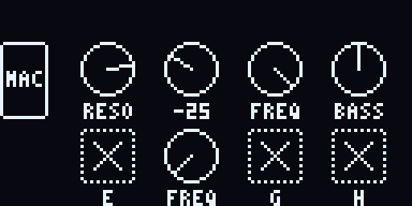
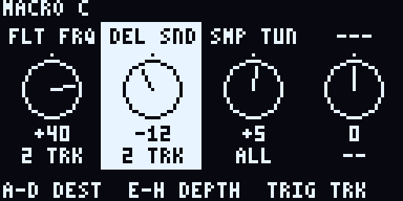

# Elektron Digitakt 2 & Digitone 2 macro-mode

Eight performance macros for the **Elektron Digitakt II** and **Digitone II**. Hold PAGE and press MOD, and encoders
A–H become eight macro knobs. Each macro moves up to four sound parameters, on the tracks you choose, all at once.
They work like the stock modulation: they ride on top of the sound and don't change your kit. Macro mode is a page
like the others: every key it doesn't use keeps its usual job.

&nbsp;&nbsp;&nbsp;&nbsp;

> [!WARNING]
> **Experimental.** Earlier builds have run on a Digitakt II; this one, with the per-kit setups, has so far only run
> in an emulator, and the Digitone II version has never been on a unit. Don't install it on a device you rely on. This is unofficial custom firmware: you use it at your own risk, and
> it is not made or supported by Elektron.

## What you need

- A **Digitakt II on OS 1.17** or a **Digitone II on OS 1.12**. Other OS versions won't work.
- The matching official OS file (`.syx`) from [Elektron's website](https://www.elektron.se/support-downloads).
- A computer with Linux or macOS to build the firmware. There is no ready-made download: the result contains
  Elektron's firmware, so it can't be shared. You build it yourself from your own copy of the OS.

## Using it

**Macro screen**

| Do this | And |
| --- | --- |
| Hold PAGE + press MOD (or MOD + PAGE) | Macro mode opens: MOD lights blue |
| Turn encoders A–H | Move that macro (−64 … +63). Push and turn for bigger steps |
| FUNC + push an encoder | Open setup of that macro |
| FUNC + push and hold an encoder | Name the macro (5 characters) |
| Turn LEVEL/DATA | Move all eight macros together |
| FUNC + NO, or push LEVEL/DATA | All macros back to the centre |
| MOD, or a page key (TRIG, SRC, FLTR, AMP, FX) | Leave macro mode |
| Any other key: PRESET, SETTINGS, SAMPLES, TEMPO, KEYBOARD, PTN, SONG, TRK, PAGE, the trig keys … | What it does on any page. Menus, popups and mute mode open over the macro screen, and macro mode is back when they close |
| In mute mode (FUNC + TRK) | The trig keys mute and FUNC + trig prepares mutes, while the encoders, their pushes, LEVEL/DATA and MOD stay macro mode's. PAGE + MOD enters macro mode from mute mode too |

**Setup screen**: FUNC + push an encoder opens the setup of that macro.

| Do this | And |
| --- | --- |
| Encoders A–D | Choose what parameters 1–4 control, from a list like the stock modulation setup |
| Encoders E–H | How far each one moves (its depth, positive or negative; push for whole steps) |
| LEFT / RIGHT | Select one of the four parameters |
| Trig keys | Choose the tracks the selected parameter acts on (lit red) |
| NO or MOD | Back to the macro screen |

The macro setup is saved on the unit and comes back after a restart.

### One setup per project, or one per kit

In **SETTINGS > PERSONALIZE > MACRO SETUP** you choose where the macro setup lives:

- **PROJECT** (default): one setup for the whole project.
- **KIT**: each pattern's kit has its own setup, which comes on with the pattern. A kit without one starts as a copy
  of the current setup.

Switching between the two loses nothing: the project and every kit keep their own setup. Copying a pattern or a kit
takes its setup along. The setups are saved inside the project.

## Your projects stay safe

- A project saved with macro-mode still opens on the official OS. It just has no macros there.
- A project from the official OS opens with macro-mode; its kits start without macro setups.
- The macro setups are stored in spare room in the project file that the official OS leaves empty. If something else
  has already put data there, macro-mode leaves it alone and shows **MACRO SETUP CONFLICT**.

## Installing

You build the firmware file yourself, on your computer, from Elektron's official OS: `tools/build.sh` patches
macro-mode into the OS file you give it.

1. **Install the tools:** Python 3.9 or newer, Git, a C compiler and the ColdFire (m68k) cross-compiler.
   - Ubuntu or Debian: `sudo apt install python3 git gcc gcc-m68k-linux-gnu binutils-m68k-linux-gnu`
   - macOS: the Xcode command line tools (`xcode-select --install`), then with [Homebrew](https://brew.sh):
     `brew install python m68k-elf-gcc`
2. **Get this project** with the loader it builds with (the `--recurse-submodules` matters: the loader is a
   submodule, and without it the build stops with "third_party/elekloader is empty"):

   ```bash
   git clone --recurse-submodules https://github.com/toonst/digi_macro.git
   ```

   Already have it? Update both: in the `digi_macro` folder, `git pull` and then `git submodule update --init`
   (a pull alone keeps the old loader).
3. **Download the official OS** from [Elektron's website](https://www.elektron.se/support-downloads): **Digitakt II
   OS 1.17** or **Digitone II OS 1.12**, exactly that version. If the download is a `.zip`, give the build the `.zip`
   itself or the `.syx` inside it. The build knows the file by its checksum and refuses any other version or a changed file.
4. **Build.** In the `digi_macro` folder, give the build the OS file (or both, one after the other):

   ```bash
   tools/build.sh path/to/Digitakt_II_OS1.17.syx
   ```

   It knows from the file which device it is for, and ends with

   ```text
   == firmware ready (send it to the unit as an OS update; keep it to yourself: it holds Elektron's OS)
     …/digi_macro/out/macro-dt2.syx
   ```

   `out/macro-dt2.syx` (Digitakt II) or `out/macro-dn2.syx` (Digitone II) is the firmware file. It holds Elektron's
   firmware: keep it for yourself, don't share it. Everything else the build makes is in `out/build`. If something
   goes wrong:

   | It says | Then |
   | --- | --- |
   | `no such file: …` | The path to the OS file is wrong |
   | `no ColdFire compiler` | Step 1: the cross-compiler is missing (or set `ELEKLOADER_CROSS` to its prefix) |
   | `third_party/elekloader is empty` | Step 2: `git submodule update --init` |
   | `… not a stock firmware elekloader knows` (or `the zip holds no stock firmware …`) | Not Elektron's OS file as published |
   | `… macro-mode needs a Digitakt II OS 1.17 or a Digitone II OS 1.12` | Another device or OS version: step 3 |
   | Anything else, such as `BUILD FAILED` or `REFUSED` | No firmware file was written. Open an issue with the whole output |

5. **Flash it** as you would an official OS update: connect the unit over USB, open Elektron Transfer, select the
   unit and **Connect**, drag the `.syx` onto **Drop files here**, and press **YES** on the unit. Don't turn it off
   until the update is done.
6. **Check it worked:** hold PAGE and press MOD. The header should say "Macro Mode".

To rebuild after an update, repeat steps 2 (the update) and 4: the new file replaces the old one in `out`.

**Going back to the official OS:** send the official `.syx` the same way. If the unit doesn't start, hold FUNC while
powering on, press TRIG 4 (OS UPGRADE), and send the official `.syx` with Transfer's legacy OS upgrade mode, over the unit's
MIDI ports (not USB).

## Good to know

- Macros are for playing live: they can't be recorded or parameter-locked, and they never change the saved sound.
- Machine-specific parameters (on the Digitone II, all synth parameters) and the LFOs can't be chosen as macro
  targets yet.
- Building without the per-kit setups: `MM_KITS=0 tools/build.sh …`. Then there's one setup, kept on the unit.

## More

- [docs/DEVELOPING.md](docs/DEVELOPING.md): building, checks, storage details and the code's layout
- [docs/STATUS.md](docs/STATUS.md): what's done and what's open
- [docs/TESTING-ON-A-UNIT.md](docs/TESTING-ON-A-UNIT.md): a checklist for trying it on your unit
- [SPEC.md](SPEC.md) and [PLAN.md](PLAN.md): what it should do and how it was planned

Built with [elekloader](https://github.com/elekloader/elekloader) and tested in
[digikit](https://github.com/toonst/digikit)'s emulator. Licence: GPL-2.0-or-later ([LICENSE](LICENSE)).
