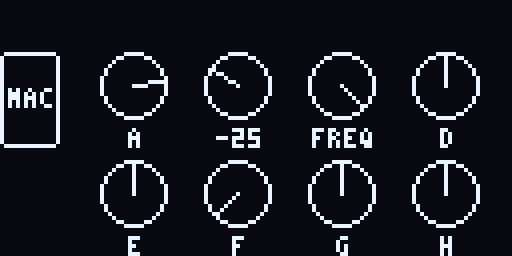
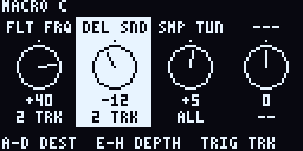
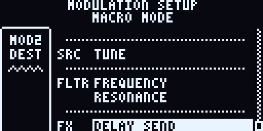

# macro-mode

A performance macro mode for the **Digitakt II (OS 1.17)** and **Digitone II (OS 1.12)**, as an
[elekloader](https://github.com/elekloader/elekloader) mod. Hold PAGE and press MOD (or the other way round): encoders A–H
become eight macros, each moving up to four parameters on the tracks you choose, on top of the sound like the stock
modulations. Requirements: [SPEC.md](SPEC.md); plan and decisions: [PLAN.md](PLAN.md); where it stands:
[docs/STATUS.md](docs/STATUS.md).

> **Development build.** On both devices everything runs in digikit's emulator (screens, LEDs, the macros in the
> frame values, the stored configuration), but nothing has been tried on a unit or listened to yet. Do not flash it
> on a device you need.

## Using it

| | Macro screen | Setup screen |
| --- | --- | --- |
| Enter | Hold PAGE and press MOD, or hold MOD and press PAGE (the header shows "Macro Mode") | FUNC + push an encoder (A–H) |
| Name a macro | FUNC + push and hold its encoder: the stock naming screen (5 characters) | The same |
| Encoders A–H | Move that macro (−64 … +63), with the stock knobs' feel; push and turn for bigger steps | A–D: destination of parameter 1–4, from a list as in the stock modulation setups; E–H: its depth (−128.00 … 127.99, push for whole steps) |
| Push + NO | The macro back to the centre | That knob back: destination none, depth 0 |
| Trig keys | Their usual function | The tracks of the selected parameter (red; all of them for a new one) |
| LEFT / RIGHT | Their usual function | Select a parameter |
| NO | Its usual function | Close the destination list; else back to the macro screen |
| LEVEL/DATA | Move all eight macros together | Move the macro being edited |
| FUNC + NO, or push LEVEL/DATA | All eight macros back to the centre (the pattern is not reloaded) | FUNC + NO: the same; LEVEL/DATA: the macro being edited |
| TRIG, SRC, FLTR, AMP, FX; FUNC + MOD | Leave macro mode and open that page (FUNC + MOD: the compressor and mixer pages, as anywhere) | The same |
| TRK + trig key | Leave macro mode and select that track, on the page macro mode was entered from | The same |
| MOD | Leave macro mode (also with PAGE held) | Back to the macro screen |

PLAY, STOP, RECORD, PTN, SONG, TRK and FUNC keep their stock function throughout. While the mode is on, the MOD key
is lit blue and the other page keys are dark. A firmware screen that opens over the mode (the firmware update's
confirmation, a dialog) takes the screen and the keys as on any page.

### Per project or per kit

SETTINGS > PERSONALIZE > MACRO SETUP chooses which setup (the destinations, depths, tracks and names) is on:

- **PROJECT** (the default): the project's own setup.
- **KIT**: the setup of the kit on (the pattern on's). A kit that has none yet starts as a copy of the one on, and
  the setup changes when another pattern, and so its kit, comes on. The knobs stay where they are.

YES, LEFT or RIGHT on the row changes it. The project and every kit keep their own setups whichever is on, so going
from KIT to PROJECT and back changes none of them. Copying and pasting a pattern or a kit takes the kit's setup along.
The setups are saved with the project, the kits' in the kit records and the project's in its header, and come back
when it is loaded. They live in bytes the stock OS leaves unused, so the project still loads on a stock OS.

This is an optional part of the mod (see Features).

 


## Building

You need Python 3, a host C compiler and the m68k cross tools, and your own stock OS files from Elektron's site.
This repository never holds firmware. The cross tools:

- Ubuntu or Debian: `apt install gcc-m68k-linux-gnu binutils-m68k-linux-gnu`
- macOS: `brew install m68k-elf-gcc` (it brings `m68k-elf-binutils`)

`tools/check.sh` uses whichever of `m68k-linux-gnu-` and `m68k-elf-` it finds (`ELEKLOADER_CROSS` names another
prefix), and runs on the bash macOS ships.

```bash
git submodule update --init
```

```bash
DT2_SYX=path/to/Digitakt_II_OS1.17.syx DN2_SYX=path/to/Digitone_II_OS1.12.syx tools/check.sh
```

`tools/check.sh` runs the host tests, renders the screen previews (`--previews` rewrites `docs/img`), cross-compiles
both manifests and, with the stock files, builds the elekloader core and this mod for each device and patches them
into the stock OS: `out/check/macro-dt2.syx` and `out/check/macro-dn2.syx`. Those are the files to send to a device
(never commit them: they hold Elektron's firmware).

To patch by hand instead (for another version string, say), run elekloader from this directory with the submodule on
Python's module path:

```bash
PYTHONPATH=third_party/elekloader python3 -m elekloader.patch --stock path/to/Digitakt_II_OS1.17.syx --mod out/check/dt2-core/core-1.0.elemod --mod out/check/dt2-mod/macro-mode-0.1.elemod --out out/macro-dt2.syx --version MM01
```

### Features

The mod's optional parts are built in or left out when it is built. Each is a fragment of the manifest,
`mods/<dev>/<feature>.json`, that `tools/manifest.py` adds to `mods/<dev>/mod.json` (sources, flags, firmware sites,
events), and a header in `src/` that the rest of the mod calls through, empty without the feature. The one there is:

| Feature | Fragment | Left out with | What it adds |
| --- | --- | --- | --- |
| Kits | `kits.json`, `src/mm_kits.h` | `MM_KITS=0 tools/check.sh` | Setups per project or per kit, PERSONALIZE > MACRO SETUP, in the project's data (5 firmware sites, about 27 KB of RAM) |

Without it the mod keeps one setup, on the card.

### Storage and other mods

Where the mod keeps its data:

| What | Where | Whose |
| --- | --- | --- |
| The mode's state, every kit's and the project's setup while the unit runs | The mod's own RAM (its `.bss`, placed by elekloader's linker) | The mod's only |
| The configuration (the setup on, the MACRO SETUP choice) | Two card sectors the stock OS never writes (`card:` claim) | The mod's only |
| A kit's setup, the project's setup (kits feature) | The saved project: after each kit record's end mark, in the header after the name (`record:kit:`, `record:project:` claims) | Bytes the stock OS writes as zeros and never reads. They must be there to travel with the project, so they are shared with the stock OS and, possibly, a later OS or another mod |

Everything that can be the mod's own is. For the shared bytes, three rules hold:

- **Compatible either way.** The stock OS loads and saves a project the mod saved, and the files differ only in
  those bytes. The mod loads a stock OS's project and finds no setups and no conflict. Patterns and kits are the
  project's records, so the same holds for them.
- **Claimed.** The manifests claim each place as a resource name with a half-open range: `card:LO-HI` in card
  sectors, `record:kit:LO-HI` in a saved kit record, `record:project:LO-HI` in a saved project file. elekloader
  refuses two mods with the same name. `tools/storage.py` refuses any overlap, and any other mod's code site inside a
  firmware routine the mod's storage goes through (`_storage` in `mods/<dev>/kits.json`).
- **Guarded.** The mod writes only over zeros or its own setups, which carry a mark and a CRC seeded with its own
  value, and reads only its own. Anything else in those bytes is a conflict: the mod leaves it as it is, keeps no
  setup for that kit, and shows MACRO SETUP CONFLICT in the header.

Checks:

```bash
MM_WITH="path/to/other.elemod path/to/another/mod.json" tools/check.sh
```

`tools/check.sh` always checks the built manifests' claims against what the code writes (`CARD_SECTOR`, `KIT_PAD`,
`PROJ_PAD`, the setup's size). With `MM_WITH`, it also checks them against those mods, and fails on a conflict.
`tests/test_storage.py` (run by `tools/check.sh`) tests the checker on the fixtures in `tests/storage`. In the
emulator (tests/emu/README.md has the runner), `tests/emu/compat.py` covers the round trips and a conflict:

```bash
python3 tests/emu/compat.py --runner RUNNER --stock path/to/Digitakt_II_OS1.17.syx --build out/check/macro-dt2.syx --map out/check/macro-dt2.map.json --out out/emu-compat-dt2 --device dt2
```

`MM_LED_TEST=1 tools/check.sh` builds a colour test: on the macro screen trig key n lights with value
`(n − 1) × 0x10 + 1` and TRIG, SRC, FLTR, AMP, FX with `0x11`, `0x21`, `0x31`, `0x51`, `0x61`, to tell which LED value
is which colour on a unit.

Test a build in [digikit](https://github.com/toonst/digikit)'s emulator before it goes near a device
(`mise run workbench -- /path/to/out/check/macro-dt2.syx` in a digikit checkout).

## Layout

| Path | What |
| --- | --- |
| `src/mm.h` | Types and the interface of the device-independent part |
| `src/mm_logic.c` | States and the input map: entry and exit, the macro screen, the setup screen |
| `src/mm_apply.c` | Macro math, the per-track lists and their frame-time apply; the LEDs the mode holds |
| `src/mm_store.c` | The stored configuration's format; destination helpers |
| `src/mm_kits.h`, `src/mm_kits.c` | The kits feature: its interface to the glue, and its device side (the firmware's calls, the PERSONALIZE row) |
| `src/mm_scope.c` | The kits feature's logic: setups per project or per kit, loads, saves and copies |
| `src/kit.s` | The kits feature's calls from the firmware: kit records, the project's header, memcpy |
| `src/rows.s` | The PERSONALIZE row's label |
| `src/mm_draw.c` | The two screens, in the stock layout (the previews use the mod's own font; the device the firmware's) |
| `src/mm_dests.c` | The destinations per device: both from the firmware's parameter tables |
| `src/mm_glue.c` | The elekloader handlers: `ev_key`, `ev_enc`, `ev_tick`, `ev_draw`, `ev_personalize` |
| `mods/dt2`, `mods/dn2` | The elekloader manifests, one per device and OS (`mod.json`), and each feature's fragment |
| `tools/manifest.py` | The manifest a build uses: `mod.json` and the chosen features |
| `tools/storage.py` | The mod's storage claims, against what it writes and against other mods |
| `tests/` | Host tests, the preview renderer and the emulator scenarios (`tests/emu`) |
| `third_party/elekloader` | elekloader, pinned |

## Licence

GPL-2.0-or-later ([LICENSE](LICENSE)), as elekloader. Not affiliated with Elektron; flashing custom firmware is at
your own risk. The stock OS file always restores a unit (hold FUNC while powering on, TRIG 4, then send the stock
`.syx` over DIN MIDI).
